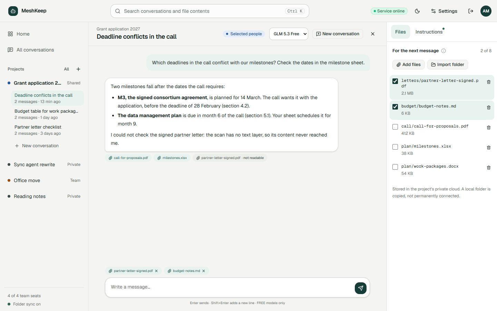
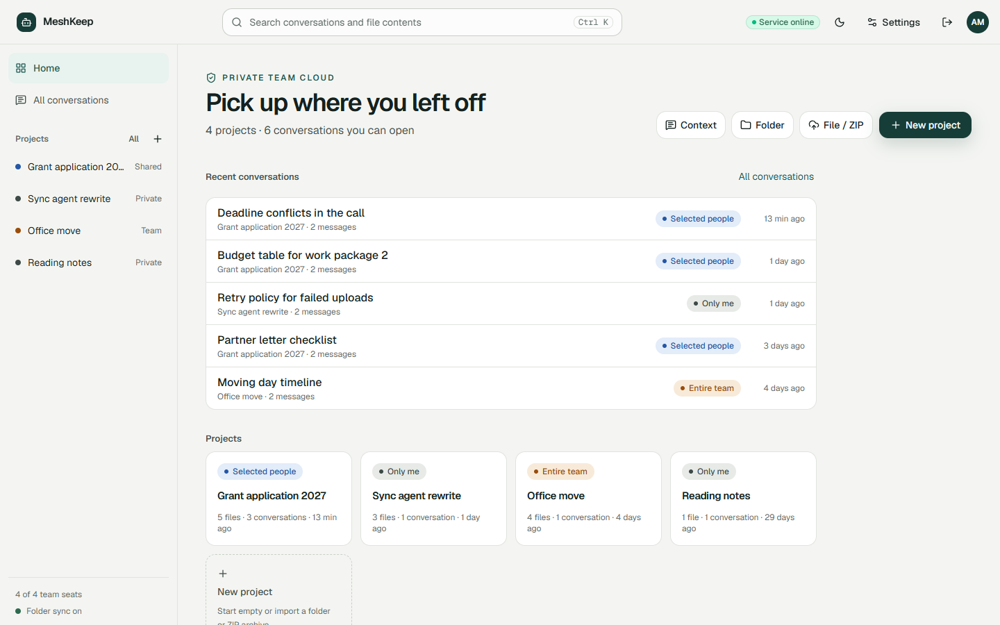
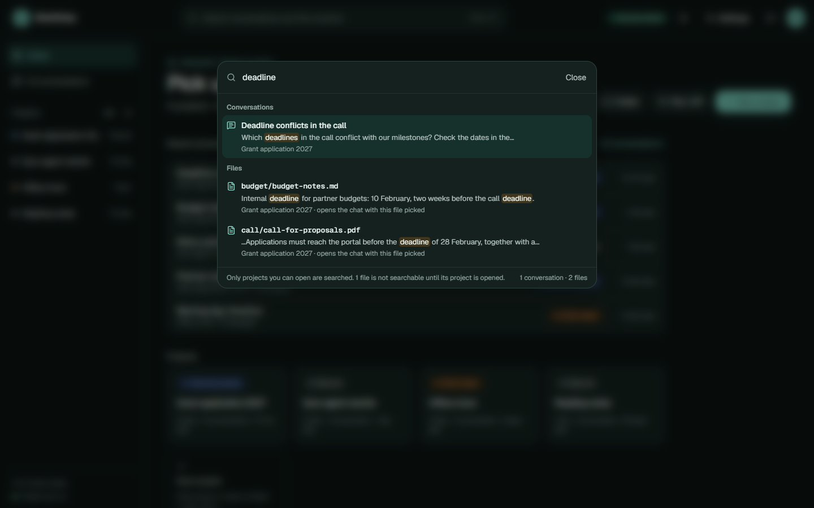
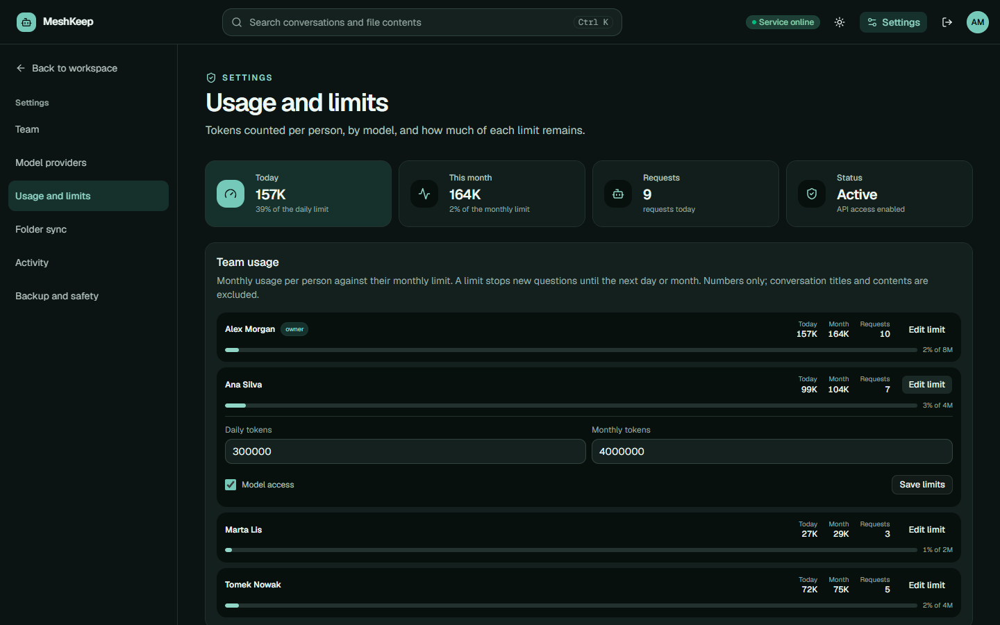
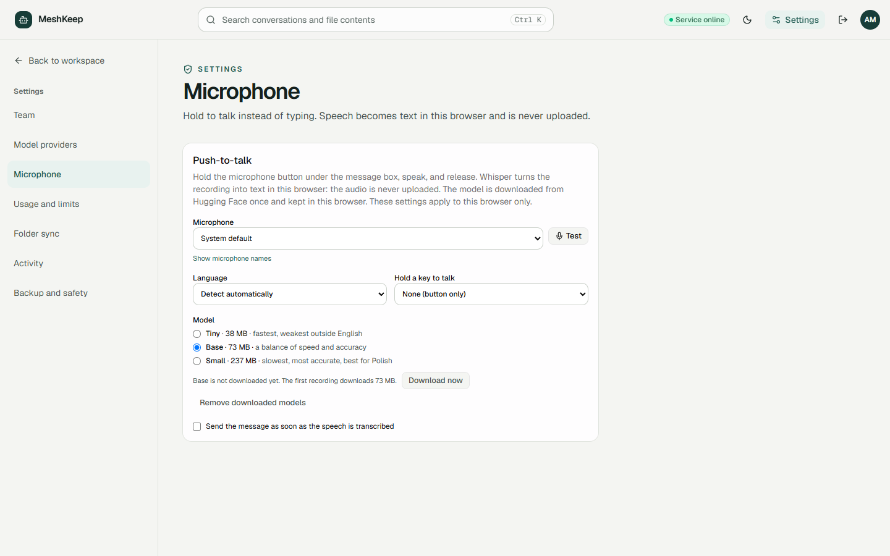
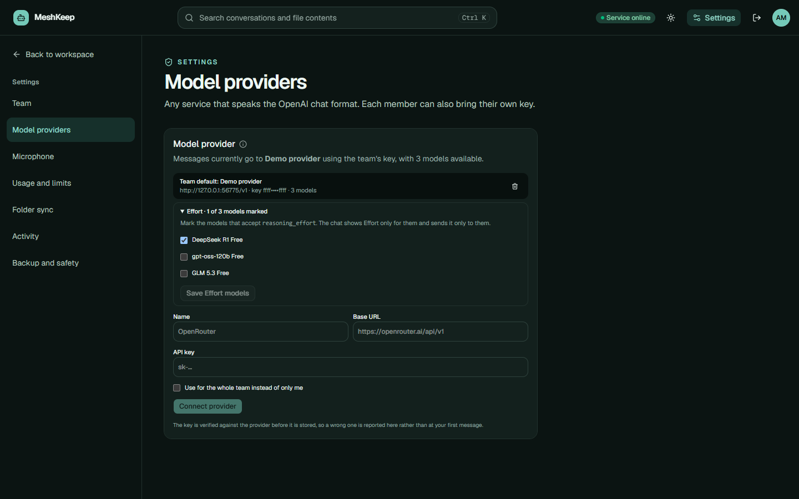

# MeshKeep

[](https://github.com/danieloza/meshkeep/actions/workflows/ci.yml)
[](https://github.com/danieloza/meshkeep/actions/workflows/secret-scan.yml)
[](https://github.com/danieloza/meshkeep/releases/latest)
[](LICENSE)
[](package.json)
[](tsconfig.json)
[](#deploy-to-cloudflare)

MeshKeep is a private, self-hostable AI workspace for teams of up to four people. Projects are private by default and can be shared with selected teammates or the entire team.

[](https://deploy.workers.cloudflare.com/?url=https://github.com/danieloza/meshkeep)

The repository contains source code and placeholders only. It does not include a hosted model key, user conversations, uploaded files, email addresses, sessions, or production database exports.

## Screenshots

Taken from a local build with demonstration data: four made-up people and their projects.

| | |
| --- | --- |
| [](docs/screenshots/chat-light.png) | [](docs/screenshots/home-light.png) |
| **Project chat.** The answer lists the files it received and flags a scanned PDF that had no text. Under the message box: files, push-to-talk, the context mode, today's tokens, the model and its Effort. | **Home.** Recent conversations and every project you can open, each marked with who can see it. |
| [](docs/screenshots/search-dark.png) | [](docs/screenshots/settings-usage-dark.png) |
| **Search (Ctrl K).** Conversations and file contents, only from projects you can open. | **Settings › Usage and limits.** Tokens per person against their daily and monthly limits. |
| [](docs/screenshots/settings-microphone-light.png) | [](docs/screenshots/settings-providers-dark.png) |
| **Settings › Microphone.** Push-to-talk runs Whisper in the browser, so recordings are never uploaded. Pick the microphone, language, model and a key to hold. | **Settings › Model providers.** Mark the models that accept Effort; the chat offers it only for them. |

## Product tour

Both videos were recorded for v0.1.0 and show the earlier interface; the screenshots above show the current one. They use demonstration data and contain no production credentials or private project content.

### Product overview — 30 seconds

A concise overview of the product, privacy model, file context, team controls, and local folder synchronization. [Download the 1080p MP4](https://github.com/danieloza/meshkeep/releases/download/v0.1.0/meshkeep-product-overview.mp4).

https://github.com/user-attachments/assets/16535886-a580-48ff-8299-929f7babe623

### End-to-end workflow — 60 seconds

A deeper walkthrough built from the real interface: private projects, selected file context, bring-your-own-provider configuration, usage controls, and the audit trail. [Download the 1080p MP4](https://github.com/danieloza/meshkeep/releases/download/v0.1.0/meshkeep-product-tour.mp4).

https://github.com/user-attachments/assets/b1159807-4531-48fb-a4cc-cced15b5b8e5

## Highlights

- Private projects with owner, editor, and reader permissions
- Three-column workspace: projects and their conversations, the chat, and the files and instructions for the next message
- Project-scoped conversations and explicit file context
- Streamed answers rendered as Markdown, with copyable code blocks
- Each answer lists the files the model received, and whether each arrived in full, in part, or not at all
- Project instructions sent ahead of every message in the project
- Full-text search across conversations and file contents from a Ctrl K palette, limited to projects the member can open
- File suggestions for the question being typed: in Manual context they are added only when picked; in Auto context they join the message and show in the composer, where any can be left out
- A composer toolbar with file upload, the context mode, the model, and today's tokens against the daily limit
- Push-to-talk: hold the microphone button, or a chosen key, and Whisper turns speech into text in the browser
- Text, code, ZIP, PDF, DOCX, XLSX, PPTX, RTF, and image uploads
- Server-side document-to-text extraction for supported documents and PDFs
- JSON context import from other assistants
- Bring-your-own OpenAI-compatible model provider, with Effort (`reasoning_effort`) for the models its manager marks
- AES-GCM encryption for provider keys stored in D1
- Windows folder-sync agent with revocable, hashed credentials
- Per-member daily and monthly token limits
- Audit log and database backup tools that exclude secrets and live sessions
- A separate Settings page for the team, model providers, usage limits, folder sync, activity, and backups
- Links that open a project, a conversation, or a Settings section directly
- Light and dark themes, with text contrast checked against WCAG AA in both

See the unauthenticated `/showcase` page for a provider-free product overview.

## Privacy and trust boundaries

The browser never receives a provider credential after it is submitted. User-supplied provider keys are validated, encrypted with AES-GCM, and then stored in D1. The encryption key lives only in `PROVIDER_KEY_ENCRYPTION_KEY` on the server. Backups omit encrypted credentials, and logs contain only provider labels and response status codes.

Local folders are not mounted or watched by the web application. Files enter a project only after an explicit browser import or through the separately authorized sync agent. A chat request receives only the files selected for that message, and the answer shows which of them reached the model and in what form. In Auto context mode, the files search suggests for the question count as selected: they show in the composer before sending, and any of them can be removed. Unsupported binaries and images remain project assets and are not silently converted into model context.

Push-to-talk transcribes speech in the browser with Whisper running in a Web Worker, on the CPU through ONNX Runtime's WebAssembly build, which MeshKeep serves itself. Recordings are not uploaded to MeshKeep or anywhere else; only the text, after the member sends it, reaches the model provider like anything typed. The model weights (38, 73 or 237 MB, chosen in Settings › Microphone) are downloaded from Hugging Face on first use and kept in the browser's cache, and can be removed there. The content security policy allows exactly that: `'wasm-unsafe-eval'` for the runtime, and `https://huggingface.co` with `https://*.hf.co` for the weights. `Permissions-Policy` allows the microphone for MeshKeep's own origin only. In our tests a synthesized English sentence came back word for word with the Base model; a Polish one had one word wrong with Base and none with Small.

Uploaded objects use random R2 keys. Invitation, session, and sync-agent credentials are stored as hashes. Authorization is enforced by server routes; client-side visibility is only a user-interface convenience.

## Model providers

MeshKeep accepts services that expose OpenAI-compatible `/models` and `/chat/completions` endpoints. Settings › Model providers holds connections: each one is an address and a key. Every member can add up to eight of their own, and the owner up to eight for the whole team. The chat offers the models of all of them, grouped by connection, and sends each message through the connection its model came from. Without any connection, the optional `TOKENROUTER_API_KEY` environment fallback can be used by a self-hosted deployment.

- **Adding a key.** Paste it and the form recognizes the provider by its prefix. The key is checked against the provider before it is stored; OpenRouter, whose model list works without a key, is checked through its key endpoint instead.
- **Replacing a key.** The new key is checked first and replaces the old one only if the check passes, so a mistyped key never breaks the chat.
- **Status.** Each connection shows when its key last worked. A key the provider refuses during a chat marks its connection, and the panel counts it as needing attention.
- **Models.** A short model list is offered in the chat as it is. A long one, such as OpenRouter's, starts with nothing offered, and whoever manages the connection chooses the models the chat shows. A model list does not say which models accept `reasoning_effort` either, so they are marked there too; the chat offers Low, Medium and High effort for those models only and sends the parameter only to them. The environment fallback has nowhere to store marks, so it offers no Effort.
- **Usage.** Each connection shows the member's own tokens through it over the last seven days.

Provider URLs must use HTTPS. Plain HTTP is accepted only for loopback addresses so a locally running Ollama or LM Studio instance can be used. Redirects, credential-bearing URLs, IP literals, and private-network hostnames are rejected to reduce SSRF and credential-forwarding risk.

## Search

Press Ctrl K (⌘ K on macOS) or click the search bar to search conversation messages and the text of project files. Picking a file opens its project's chat with that file selected. Search uses SQLite FTS5 in D1.

- **Access:** results come only from projects the signed-in member can open. The access rule is part of the SQL query, so other projects' content never leaves the database.
- **Indexing:** plain text and code are indexed as they are uploaded. PDF and Office documents are extracted in small rounds when a project is opened or files are imported. Files uploaded before search existed become searchable the first time their project is opened.
- **Files that cannot be read:** the files panel says what became of each file's text: still being read, read only in part, no text by design (an image, a legacy `.doc`), or a read that failed, with the reason. A failed read is tried again after a pause, up to three times. Each attempt is counted before the file is read, so a document whose reading takes its round down stops being retried instead of blocking the rest.
- **Polish text:** words match without diacritics, including `ł` typed as `l`.
- **File suggestions:** while a question is being typed, the chat suggests up to five project files that match it. A suggestion only offers the file; nothing joins the model context until it is picked.

## Local development

Requirements:

- Node.js 22.13 or newer
- Windows PowerShell 5.1 or newer for the folder-sync helper

```powershell
npm ci
Copy-Item .dev.vars.example .dev.vars
npm run build
powershell -ExecutionPolicy Bypass -File scripts\ensure-local-db.ps1
npm run dev -- --host 127.0.0.1 --port 3080
```

Open `http://127.0.0.1:3080/`. Development mode creates a local placeholder owner. A deployment signs the owner in at `/setup` with `OWNER_SETUP_TOKEN`, or with ChatGPT behind OpenAI Sites; see [Authentication modes](#authentication-modes).

Generate a strong provider-encryption secret before saving provider credentials:

```powershell
$bytes = New-Object byte[] 32
[Security.Cryptography.RandomNumberGenerator]::Create().GetBytes($bytes)
[Convert]::ToBase64String($bytes)
```

Copy the generated value into `.dev.vars` as `PROVIDER_KEY_ENCRYPTION_KEY`. Never commit `.dev.vars`.

## Deploy to Cloudflare

[](https://deploy.workers.cloudflare.com/?url=https://github.com/danieloza/meshkeep)

The button copies this repository to your GitHub or GitLab account and connects it to Workers Builds, so later pushes deploy automatically. During setup Cloudflare:

- **Creates storage:** the D1 database (`DB`) and the R2 bucket (`FILES`) described in `wrangler.jsonc`.
- **Asks for two secrets:** `OWNER_SETUP_TOKEN` and `PROVIDER_KEY_ENCRYPTION_KEY`. Generate each with `openssl rand -hex 32`. The `change-me` placeholders in `.dev.vars.example` are deliberately too short, so owner setup and saved provider keys stay disabled until real values are set.
- **Builds and deploys:** `npm run build`, then `npm run deploy`, which applies the D1 migrations in `drizzle/` before the new version goes live.

After the first deploy:

1. Open `/setup` on your Worker's address and enter the setup key. This creates the owner account.
2. Connect a model provider in Settings › Model providers.
3. Invite up to three people from Settings › Team.

The deployment uses standalone authentication by default.

To deploy from your own machine instead:

```bash
npm ci
npx wrangler login
npm run build:cloudflare
npx wrangler deploy
npm run db:migrate
npx wrangler secret put OWNER_SETUP_TOKEN
npx wrangler secret put PROVIDER_KEY_ENCRYPTION_KEY
```

- **First run:** the first `wrangler deploy` creates the D1 database and the R2 bucket, and `db:migrate` then creates the tables.
- **Later releases:** `npm run build:cloudflare && npm run deploy`.
- **Build targets:** `build:cloudflare` and Workers Builds use the bindings in `wrangler.jsonc`. A plain `npm run build` keeps the OpenAI Sites placeholders, as before.

The build and a `wrangler deploy --dry-run` are checked in this repository. A full deployment on a real Cloudflare account has not been verified yet, so please report any step that fails.

## Configuration

| Variable | Purpose |
| --- | --- |
| `APP_ORIGIN` | Canonical deployment origin used for metadata and social cards |
| `AUTH_MODE` | `standalone` (default) or `sites`; see [Authentication modes](#authentication-modes) |
| `OWNER_SETUP_TOKEN` | Standalone mode: secret of at least 32 characters that creates the owner and restores owner access |
| `PROVIDER_KEY_ENCRYPTION_KEY` | Server-only secret used to encrypt user-supplied provider credentials |
| `TOKENROUTER_API_KEY` | Optional legacy server-side team provider; leave blank for BYOK-only mode |
| `OWNER_ACCOUNT_USER_ID` | Sites mode: preferred first-owner bootstrap using the hosting identity |
| `OWNER_EMAIL` | Sites mode: optional legacy first-owner bootstrap by email |
| `ALLOW_FIRST_USER_BOOTSTRAP` | Sites mode: emergency bootstrap switch; leave unset in normal production |
| `GOOGLE_DRIVE_CLIENT_ID` | Experimental server-configured Drive adapter |
| `GOOGLE_DRIVE_CLIENT_SECRET` | Experimental Drive OAuth secret |
| `GOOGLE_DRIVE_REFRESH_TOKEN` | Experimental Drive refresh token |
| `GOOGLE_DRIVE_ROOT_FOLDER_ID` | Optional Drive root for project copies |

The Drive adapter does not include an in-app OAuth setup flow. Treat it as experimental until your deployment supplies and manages OAuth credentials independently.

To deploy on OpenAI Sites instead of your own Cloudflare account, replace the placeholder `project_id` in `.openai/hosting.json`, set `AUTH_MODE=sites`, and inject production values through the hosting secret store.

### Authentication modes

MeshKeep identifies people in one of two ways, selected by `AUTH_MODE`:

- **`standalone` (default):** for any host other than OpenAI Sites. The owner opens `/setup` and enters `OWNER_SETUP_TOKEN`. The first use creates the owner account; later uses restore access to it. Everyone else joins through one-time invitation links. The `oai-authenticated-user-*` headers are ignored, because outside Sites a client could set them to any value.
- **`sites`:** only when OpenAI Sites sits in front of the worker. Sites sets the `oai-authenticated-user-*` headers, and the owner signs in with ChatGPT. `/setup` is disabled in this mode.

Never set `AUTH_MODE=sites` on a deployment that clients can reach without passing through Sites: anyone could then sign in as any user by sending those headers. Standalone is the default for that reason. A Sites deployment that forgets the setting loses ChatGPT sign-in, but it does not trust headers it cannot verify.

Generate the setup key the same way as the encryption key, and store it only in the hosting secret store. Rotating the secret invalidates the old key; existing sessions stay valid.

## Folder-sync agent

The PowerShell agent requires the target API origin explicitly, so a clone never points at the original deployment:

```powershell
powershell -ExecutionPolicy Bypass -File public\meshkeep-sync.ps1 `
  -ProjectId "your-project-id" `
  -Folder "C:\path\to\project" `
  -ApiUrl "https://your-meshkeep.example"
```

The agent stores its credential with Windows DPAPI, ignores common secret and build paths, and can optionally propagate local deletions. The server rejects suspicious bulk deletion even if the local script is modified.

## Testing

```powershell
npm run lint
npx tsc --noEmit
npm test
npm run build
npm run test:api
npm audit --omit=dev
```

The API suite runs against the built Worker and a fresh migrated database. Access-control tests therefore exercise real HTTP, sessions, SQL queries, and project ownership rules rather than mocks.

To verify a deployed instance from outside:

```powershell
npm run smoke -- https://your-meshkeep.example
```

## Database and backups

The public repository starts with one non-destructive baseline migration. It does not contain the one-time production cleanup migration used by the original private deployment. Later migrations in `drizzle/` never delete data: they add tables and columns, and a table whose primary key changes is rebuilt with every row copied, as SQLite requires. `tests/migration-baseline.test.ts` enforces both. Apply them in order before deploying a release that includes them.

The original deployment on OpenAI Sites has an older migration history, so it takes the same migrations through its own line. `npm run sites:migrations` builds that line; see [deploy/sites/README.md](deploy/sites/README.md).

Owners can export D1 data as JSON from Settings › Backup and safety. The export omits provider credentials, live sessions, invitation hashes, sync-agent hashes, R2 object bytes, and the search index. The index is derived data: restored messages are indexed again as they are inserted, and files are indexed again when their project is opened. Convert a reviewed export into restoration SQL with:

```powershell
node scripts/backup-to-sql.mjs backup.json restore.sql
```

The script writes SQL but never executes it. Review the output before applying it. Saved provider credentials are intentionally not restorable; reconnect each provider with a new credential after a restore.

## Architecture

- Next.js-compatible React application built with Vinext
- Cloudflare Worker runtime
- Drizzle ORM with D1-compatible SQLite migrations
- R2-compatible object storage
- OpenAI-compatible model-provider requests
- Hosting bindings described in `.openai/hosting.json`
- Empty screens drawn with [Hairline](https://github.com/lucasmarkes/hairline) (MIT), isometric line figures that answer the pointer; only the five figures in use are bundled, about 14 kB gzipped

## Security

Read [SECURITY.md](SECURITY.md) before deploying or reporting a vulnerability. Run the complete validation suite and review generated deployment artifacts before every release.

## License

[MIT](LICENSE)
